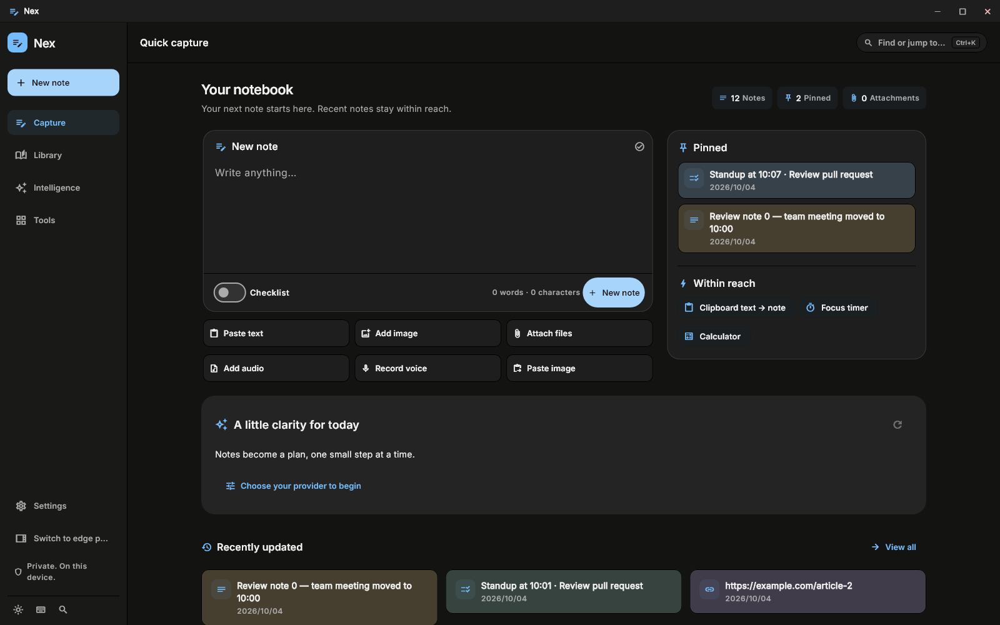

# Nex Windows

[](https://github.com/sanyzrn/Nex_windows_test/actions/workflows/desktop.yml)
[](https://github.com/sanyzrn/Nex_windows_test/releases/latest)
[](LICENSE)

A local-first notebook and desktop toolkit for Windows, with English and Persian interfaces. Work in a full desktop window or a compact panel at either screen edge.

**Current app version: `0.20.0+13` · Windows 10/11 · x64**

[Download the latest installer](https://github.com/sanyzrn/Nex_windows_test/releases/latest) · [What's new](apps/desktop/CHANGELOG.md) · [Report a bug](https://github.com/sanyzrn/Nex_windows_test/issues/new/choose) · [فارسی](#راهنمای-فارسی)



## What you can do

- Capture and search text, checklists, links, images, files and voice notes; edits save locally.
- Organize notes with tags, threads, pins and reminders. Recently deleted notes can be restored.
- Keep the last **50 distinct clipboard text/image entries** across restarts, with separate favorites.
- Use Windows tools such as Keep Awake, screenshots, window pinning, clipboard and app/folder launchers.
- Switch between the custom desktop window and an edge panel with hover navigation, tray access and a global shortcut.
- Choose a theme, language and dock layout. Tool selection is searchable and paginated.

The note schema, attachment and backup handling, and 14 palette identities are aligned with [DbsNex Android 2.1.4](https://github.com/sanyzrn/DbsNex/tree/34514226260dc8b1d3da35f91082dbfa9ce46b93). [Cross-platform contract and validation](docs/CROSS_PLATFORM_0150.md). Windows keeps its own version and native integrations.

New versions publish automatically to [Releases](https://github.com/sanyzrn/Nex_windows_test/releases/latest) after the full main-branch [Windows CI run](https://github.com/sanyzrn/Nex_windows_test/actions/workflows/desktop.yml) passes. The release contains the verified installer and matching `SHA256SUMS`. While CI is running, Releases continues to show the previous public version.

## Install and update

1. Open [Releases](https://github.com/sanyzrn/Nex_windows_test/releases/latest) and download the installer belonging to that release.
2. Close any running Nex instance using its tray menu before upgrading.
3. Run the installer. It installs for the current user without administrator privileges and includes the runtime dependencies.

The installer offers Persian/English pages and a dark Nex design. It is currently **unsigned**. User notes, media and settings are stored separately from program files; the installer keeps the existing application identity and data locations.

Verify a download against the `SHA256SUMS` asset from the **same release**:

```powershell
Get-FileHash .\Nex-Windows-Setup-*-x64.exe -Algorithm SHA256
```

Generated installers belong in GitHub Release assets. Git tracks source, assets, tests and documentation; local SDKs, build caches and installer EXEs are intentionally excluded.

## Getting started

| Action | Shortcut / location |
| --- | --- |
| Open quick capture | `Ctrl+Alt+N` globally; configurable in Settings |
| New note / checklist | `Ctrl+N` / `Ctrl+Shift+N` |
| Search or jump to a note/tool | `Ctrl+K` |
| Open library / settings | `Ctrl+L` / `Ctrl+,` |
| Manage tags | Library → **Manage tags** |
| Switch interface mode | Sidebar or Settings → Display & interface |
| Choose tools | Settings → Docked tools & apps → Dock / More / Hidden |
| Keyboard help | `F1` |

## Build and test

Use Windows x64, **Flutter 3.44.8**, and Visual Studio with the **Desktop development with C++** workload. Use the default `pub.dev` package host. The independent Android checkout may use a different SDK; Windows goldens are validated with this pinned version.

```powershell
git clone https://github.com/sanyzrn/Nex_windows_test.git
cd Nex_windows_test/apps/desktop
flutter pub get --enforce-lockfile
flutter analyze --no-pub
flutter test --no-pub
flutter build windows --release --no-pub
```

Distribute the complete `build/windows/x64/runner/Release` folder, not only its EXE. Packaging uses Inno Setup **6.7.3**: [installer guide](apps/desktop/installer/README.md).

CI runs version checks, package-host/UI checks, analysis, desktop tests and Windows goldens, shared UI tests, the Release build, installer packaging and on-device runtime removal verification. Successful runs retain an executable bundle and an installer with checksums. [Release process and CI diagnosis](docs/RELEASING.md).

## Project layout

| Path | Purpose |
| --- | --- |
| `apps/desktop` | Flutter application, Windows C++ bridge, installer and regression tests |
| `packages/core`, `data`, `ui`, `ai` | Vendored shared Nex packages; Android-compatible cloud AI; the on-device runtime stays removable |
| `design` | Screenshots, design reviews and actual Release probe results |
| `docs` | Architecture, validation, release guidance and historical reports |
| `patches` | Historical upstream transfer patches; already applied here |

[0.20 intelligence and design](docs/WINDOWS_0200.md) · [Architecture and data](apps/desktop/README.md) · [Compatibility validation for 0.15.0](docs/CROSS_PLATFORM_0150.md) · [Contributing](CONTRIBUTING.md) · [Upstream integration](docs/INTEGRATION.md)

## Current limits

The Intelligence workspace supports five cloud providers, conversation history, note actions with review, OCR, transcription, translation, rewriting, summaries and semantic search. AI is off by default, uses your own provider credentials, and stores keys in Windows secure storage. Local models have a clearly marked placeholder. Cloud/LAN sync, Vault, local inference and automatic app updates are not enabled. Further repeating-reminder occurrences need the app to run again; indefinite recurrence while fully exited is not implemented. Physical dual-monitor mixed-DPI/hot-plug behavior, full installed-notification delivery and clean-machine upgrades remain manual validation areas. See the dated validation reports for what was actually tested.

## راهنمای فارسی

نکس ویندوز یک دفتر یادداشت محلی با ابزارهای کاربردی ویندوز است. نسخهٔ فعلی **۰٫۱۴٫۰، بیلد ۱۱** است و دو حالت پنجره و پنل کناری دارد.

- [آخرین نصاب و فایل بررسی SHA-256](https://github.com/sanyzrn/Nex_windows_test/releases/latest) را از بخش Releases دریافت کنید؛ لینک دانلود داخل گزارش‌های قدیمی، نسخهٔ جاری محسوب نمی‌شود.
- قبل از ارتقا، برنامهٔ باز را از منوی کنار ساعت ببندید. یادداشت‌ها، رسانه‌ها و تنظیمات در مسیر جدا از فایل‌های نصب نگه‌داری می‌شوند.
- مدیریت ساخت، ویرایش و حذف تگ در کتابخانه است. در تنظیمات، انتخاب ابزارها با جست‌وجو و گزینه‌های «داک، بیشتر، پنهان» انجام می‌شود.
- کلیپ‌بورد ۵۰ مورد اخیر متن/تصویر را نگه می‌دارد و علاقه‌مندی‌ها جدا هستند.
- [گزارش باگ](https://github.com/sanyzrn/Nex_windows_test/issues/new/choose) را با نسخهٔ برنامه، مشخصات مانیتورها و مراحل بازتولید ثبت کنید؛ فارسی و انگلیسی پذیرفته می‌شوند.

## License and acknowledgements

The standalone Windows project uses the [MIT license](LICENSE). Shared packages and the desktop shell retain their upstream notices. Shell references include [raminturne/right-panel](https://github.com/raminturne/right-panel). Fonts, plugins and upstream attribution are listed in [THIRD_PARTY_NOTICES](apps/desktop/THIRD_PARTY_NOTICES.md).
