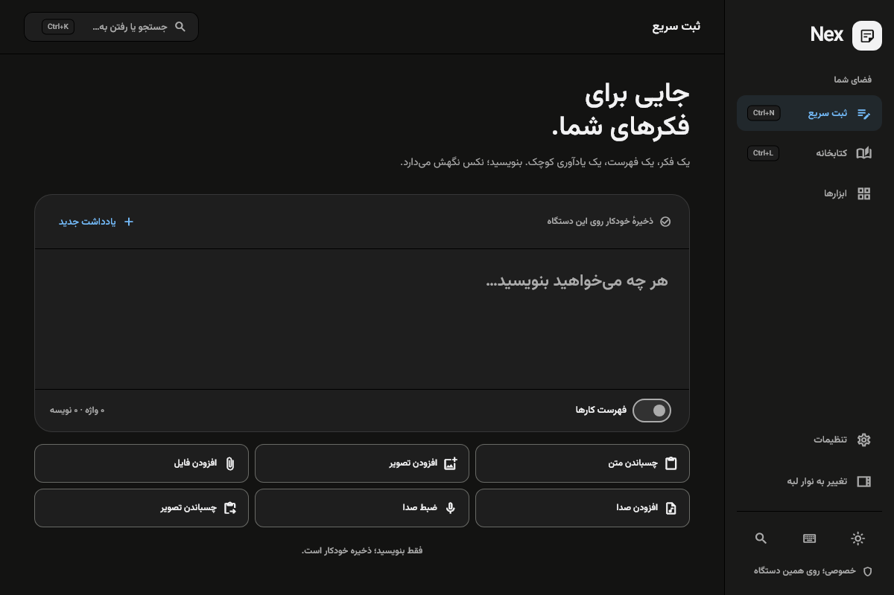
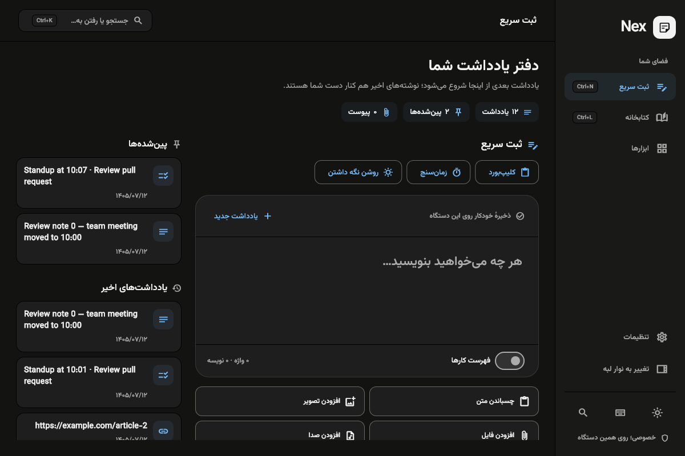
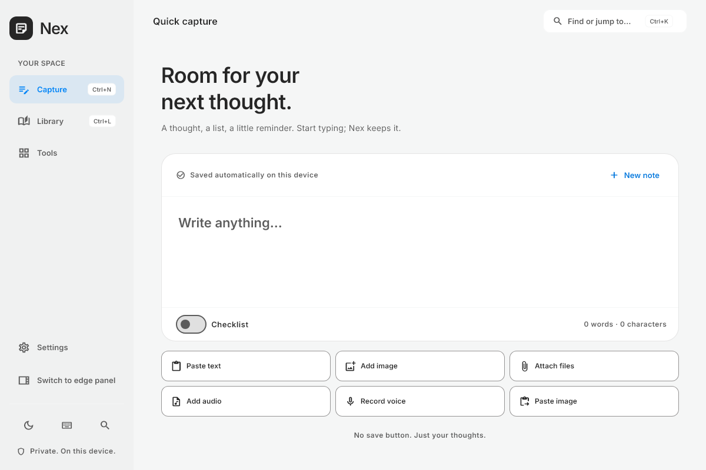
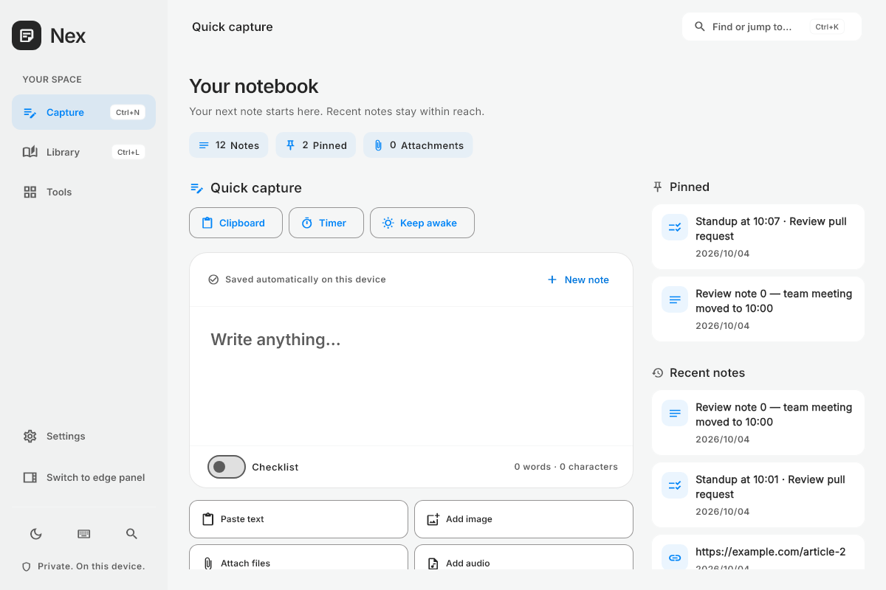
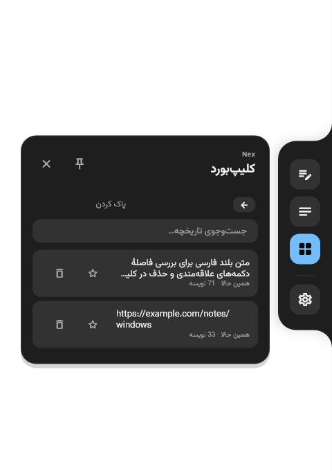
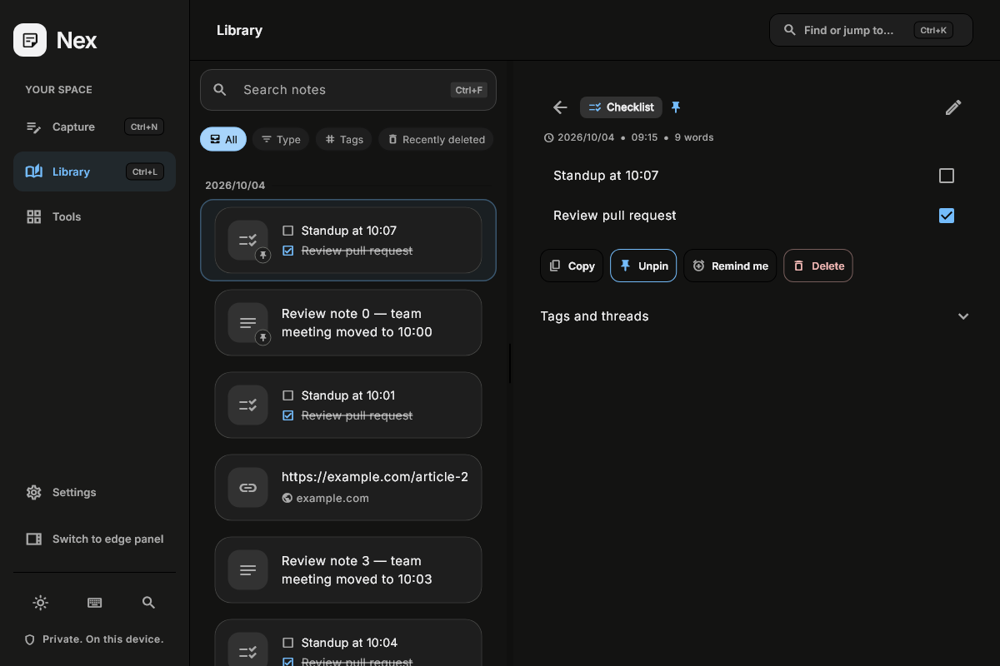

# Product workspace — 2026-10-14

The home now combines capture and retrieval: exact totals, pinned notes, recent notes and Windows utility shortcuts. Library reading starts with a real note; clipboard controls have their own space; dock hover has a shared center.

The before images were copied from the preceding appearance phase before this iteration. After images are rendered from the current implementation with seeded notes, bundled fonts and real shadows.

| Before | After |
| --- | --- |
|  |  |
|  |  |

See [the implementation and validation report](../../docs/PRODUCT_ITERATION.md) for functionality, evidence and remaining reminder limitations.
